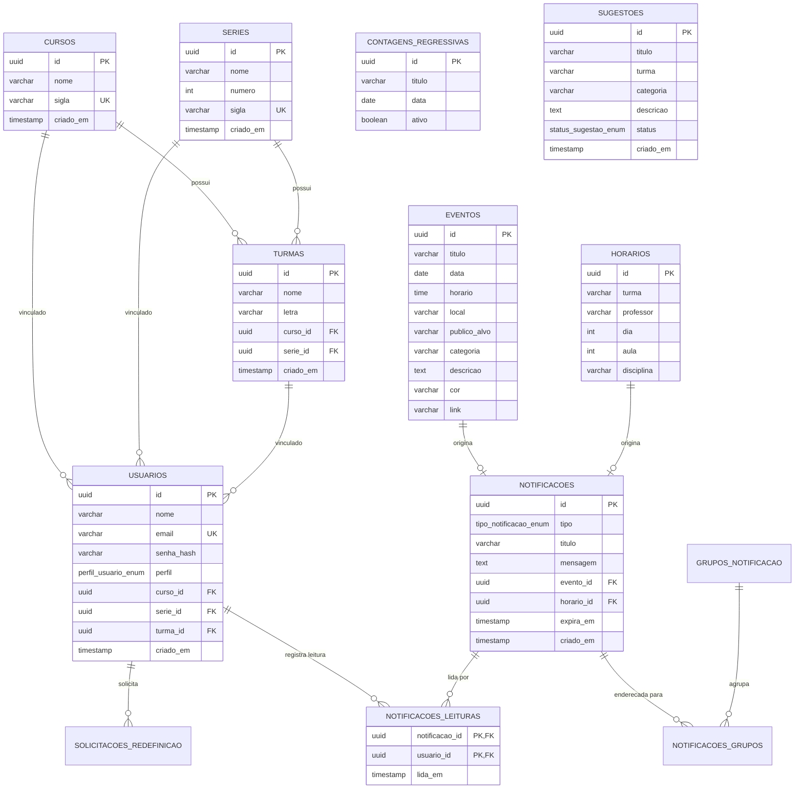

# Escopo do Backend — Portal ETE (API REST)

Documento oficial de especificação de escopo, arquitetura, módulos funcionais, regras de negócio e contratos de dados da API do **Portal ETE** (Escola Técnica Estadual).

---

## 1. Visão Geral e Propósito

O backend do **Portal ETE** é uma API REST desenvolvida para centralizar a gestão pedagógica, institucional e de comunicação de uma Escola Técnica Estadual. Sua responsabilidade central é fornecer serviços seguros, escaláveis e de alta integridade relacional para autenticação, controle acadêmico, mural de eventos, grade horária de aulas, contagens regressivas, ouvidoria estudantil e notificações segmentadas por turma.

### Objetivos Principais
* **Isolamento e Pertencimento Estudantil:** Garantir que alunos acessem com precisão os dados pertinentes ao seu curso, série e turma (como horários e eventos exclusivos), sem perder a visibilidade de eventos gerais da escola.
* **Autonomia Docente e Administrativa:** Prover ferramentas para que professores publiquem atividades e administradores gerenciem grades horárias, aprovem solicitações de redefinição de senha e coordenem sugestões.
* **Didática e Padronização:** Manter nomenclatura de banco de dados e domínios em Português do Brasil (`usuarios`, `eventos`, `horarios`, etc.), com código em TypeScript limpo, tipado e modular.

---

## 2. Arquitetura e Tecnologias

A aplicação segue a arquitetura orientada a módulos do **NestJS**, com injeção de dependências, filtros globais e validação estrita por DTOs.

```
┌─────────────────────────────────────────────────────────────┐
│                       Clientes HTTP                         │
│             (Frontend Next.js / Mobile / Postman)           │
└──────────────────────────────┬──────────────────────────────┘
                               │ JSON / REST (Bearer Token JWT)
                               ▼
┌─────────────────────────────────────────────────────────────┐
│                    API Gateway / NestJS                     │
│  ┌──────────────────────┐  ┌─────────────────────────────┐  │
│  │ AutenticacaoGuard    │  │ PapeisGuard (RBAC)          │  │
│  └──────────────────────┘  └─────────────────────────────┘  │
│  ┌──────────────────────┐  ┌─────────────────────────────┐  │
│  │ AuthModule           │  │ SchoolModule                │  │
│  └──────────────────────┘  └─────────────────────────────┘  │
│  ┌──────────────────────┐  ┌─────────────────────────────┐  │
│  │ NotificacoesModule   │  │ TypeORM Migrations Runner   │  │
│  └──────────────────────┘  └─────────────────────────────┘  │
└──────────────────────────────┬──────────────────────────────┘
                               │ Pool SQL / TCP
                               ▼
┌─────────────────────────────────────────────────────────────┐
│                  PostgreSQL Database 16                     │
│          Tabelas em Português / UUIDs / Relacionamentos     │
└─────────────────────────────────────────────────────────────┘
```

* **Linguagem & Plataforma:** Node.js (>= 20) com TypeScript 5.x.
* **Framework Web:** NestJS 10.x.
* **Mapeamento Objeto-Relacional (ORM):** TypeORM 0.3.x com migrations versionadas.
* **Banco de Dados:** PostgreSQL 16 com extensões nativas (`uuid-ossp` / `gen_random_uuid()`).
* **Segurança & Autenticação:** Passport JWT (`@nestjs/jwt`), hashing criptográfico com `bcryptjs`.
* **Validação de Entrada:** `class-validator` e `class-transformer` com validação de payload em tempo de execução.
* **Infraestrutura:** Docker e Docker Compose com healthcheck no Postgres.

---

## 3. Módulos Funcionais e Escopo Detalhado

O sistema é dividido em três domínios funcionais coesos:

### 3.1. Módulo de Autenticação e Usuários (`AuthModule`)
* **Cadastro Institucional (`RegisterDto`):**
  * Cadastro de estudantes com associação institucional opcional/obrigatória: Curso (`courseId`), Série (`gradeId`) e Turma (`classGroupId`).
  * Cadastro de perfis privilegiados (`professor` e `admin`) mediante apresentação de código de autorização institucional fixado (`@ProfAcesso10` para docentes e `@AdmAcesso10` para administradores).
* **Autenticação e Sessão (`LoginDto`):**
  * Emissão de token JWT assinado contendo `id`, `email` e `role`.
  * Endpoint de identificação do usuário corrente (`GET /api/auth/me`) com resolução de relações acadêmicas (curso, série e turma vinculados).
* **Recuperação e Redefinição de Senha:**
  * Solicitação aberta com justificativa (`POST /api/auth/recuperacao/solicitacoes`).
  * Fila administrativa de auditoria e aprovação (`GET` e `PATCH /api/auth/recuperacao/solicitacoes/:id/aprovar`).
  * Emissão de código alfanumérico seguro (6 caracteres) com validade de 24 horas.
  * Conclusão da troca de senha validada pelo código (`POST /api/auth/recuperacao/redefinir`).
* **Atualização de Perfil:**
  * Permite ajuste de nome e vinculação acadêmica (`PATCH /api/auth/perfil`).

### 3.2. Módulo de Gestão Escolar e Acadêmica (`SchoolModule`)
* **Estrutura Acadêmica Normalizada:**
  * Catálogo de Cursos (`cursos`), Séries (`series`) e Turmas (`turmas`).
  * Fornecimento da árvore estrutural completa para selects dinâmicos do frontend (`GET /api/academic/structure`).
* **Mural de Eventos (`eventos`):**
  * CRUD completo de eventos com título, data, horário, local, categoria, público-alvo textual/estruturado, cor temática e link externo.
  * Publicação e exclusão liberadas para Administradores e Professores.
  * Leitura pública/autenticada por proximidade de data (`date ASC`).
* **Grade Curricular e Horários (`horarios`):**
  * Alocação de aulas com dia da semana (1 a 5), número do tempo de aula (1 a 9), disciplina, turma e professor responsável.
  * Gestão restrita aos Administradores.
* **Contagens Regressivas (`contagens_regressivas`):**
  * Fixação de marcos temporais para vestibulares, feiras ou provas (ex.: ENEM 2026).
* **Mural de Sugestões / Ouvidoria (`sugestoes`):**
  * Canal para estudantes enviarem ideias e solicitações à gestão (`POST /api/suggestions`).
  * Painel administrativo para moderação com triagem de status (`pendente`, `aprovada`, `reprovada`).

### 3.3. Módulo de Notificações e Segmentação (`NotificacoesModule`)
* **Geração Automática de Alertas:**
  * Disparada sempre que novos eventos ou horários de aula são criados ou atualizados no sistema.
* **Segmentação por Grupos Acadêmicos (`grupos_notificacao`):**
  * Grupo `geral` (para toda a escola).
  * Grupos por curso (`curso:DS`, `curso:NUT`).
  * Grupos por série (`serie:1`, `serie:2`, `serie:3`).
  * Grupos por turma específica (`turma:1DSA`, `turma:2DSA`, `turma:3NUTB`, etc.).
* **Isolamento de Leitura por Perfil:**
  * Tabela associativa `notificacoes_leituras` registra o timestamp de leitura por par `(notificacao_id, usuario_id)`.
  * **Regra de Negócio Crucial:** A visualização/leitura de uma notificação por um administrador ou professor **não afeta** os alunos. A notificação permanece como não lida para o estudante até que ele abra seu próprio painel.

---

## 4. Matriz de Perfis e Permissões (RBAC)

O backend valida as permissões em nível de rota através do `PapeisGuard` e do decorador `@Roles(...)`:

| Recurso / Operação | Método / Rota | Público | Aluno | Professor | Administrador |
| :--- | :--- | :---: | :---: | :---: | :---: |
| **Login e Registro** | `POST /api/auth/login`, `register` | Sim | Sim | Sim (com token) | Sim (com token) |
| **Identificação da Conta** | `GET /api/auth/me` | Não | Sim | Sim | Sim |
| **Atualização de Perfil** | `PATCH /api/auth/perfil` | Não | Sim | Sim | Sim |
| **Solicitar Troca de Senha** | `POST /api/auth/recuperacao/solicitacoes` | Sim | Sim | Sim | Sim |
| **Redefinir Senha com Código**| `POST /api/auth/recuperacao/redefinir` | Sim | Sim | Sim | Sim |
| **Aprovar Solicitações de Senha**| `GET`, `PATCH /api/auth/recuperacao/...` | Não | Não | Não | **Sim** |
| **Consultar Estrutura Acadêmica**| `GET /api/academic/structure`, `/courses`, etc. | Sim | Sim | Sim | Sim |
| **Consultar Eventos** | `GET /api/events` | Sim | Sim | Sim | Sim |
| **Criar / Deletar Eventos** | `POST`, `DELETE /api/events` | Não | Não | **Sim** | **Sim** |
| **Consultar Horários** | `GET /api/schedules` | Sim | Sim | Sim | Sim |
| **Cadastrar / Deletar Horários** | `POST`, `DELETE /api/schedules` | Não | Não | Não | **Sim** |
| **Consultar Contagens** | `GET /api/countdowns` | Sim | Sim | Sim | Sim |
| **Cadastrar / Deletar Contagens**| `POST`, `DELETE /api/countdowns` | Não | Não | Não | **Sim** |
| **Enviar Sugestão** | `POST /api/suggestions` | Não | **Sim** | Não | Não |
| **Moderar Sugestões** | `GET`, `PATCH`, `DELETE /api/suggestions` | Não | Não | Não | **Sim** |
| **Listar / Ler Notificações** | `GET`, `PATCH /api/notifications` | Não | Sim | Sim | Sim |

---

## 5. Modelo de Dados Relacional (PostgreSQL)

### 5.1. Diagrama Entidade-Relacionamento



### 5.2. Histórico de Migrações do TypeORM

O banco de dados é versionado e idempotente por migrações em `backend/src/migracoes/`:

1. `1727200000000-TraduzirEstruturaBancoDados`: Padronização de nomes das tabelas de inglês para português (`usuarios`, `eventos`, `horarios`, etc.).
2. `1727200000001-CriarRecuperacaoSenha`: Criação da tabela de solicitações com status e tokens de recuperação.
3. `1727200000002-AjustarRecuperacaoPorCodigo`: Evolução para fluxo administrativo por código de 6 dígitos expirable.
4. `1727200000003-VincularAlunoCursoSerieTurma`: Criação das tabelas relacionais `cursos`, `series`, `turmas` e chaves estrangeiras em `usuarios`.
5. `1727200000004-CriarNotificacoesPorGrupo`: Infraestrutura relacional de notificações segmentadas por grupo acadêmico com leitura independente por usuário.

---

## 6. Catálogo Resumido de Endpoints da API

Todas as rotas são prefixadas por `/api`.

### Autenticação & Perfil (`/api/auth`)
* `POST /api/auth/login` — Autentica usuário com e-mail e senha.
* `POST /api/auth/register` — Cria conta (valida código para docentes/gestores e vincula dados da turma do aluno).
* `GET /api/auth/me` — Retorna dados da sessão ativa e relações de turma do usuário logado.
* `PATCH /api/auth/perfil` — Atualiza dados cadastrais e vínculos escolares do usuário.
* `POST /api/auth/recuperacao/solicitacoes` — Registra pedido de recuperação de senha.
* `POST /api/auth/recuperacao/redefinir` — Redefine senha com o código aprovado.
* `GET /api/auth/recuperacao/solicitacoes` — *(Admin)* Lista solicitações pendentes.
* `PATCH /api/auth/recuperacao/solicitacoes/:id/aprovar` — *(Admin)* Aprova pedido e gera código seguro.

### Gestão Escolar & Estrutura (`/api`)
* `GET /api/academic/structure` — Retorna cursos, séries e turmas agrupados.
* `GET /api/courses`, `GET /api/grades`, `GET /api/classes` — Listagens individuais das entidades acadêmicas.
* `GET /api/events` — Retorna os eventos ordenados por data.
* `POST /api/events` — *(Prof/Admin)* Cadastra novo evento escolar.
* `DELETE /api/events/:id` — *(Prof/Admin)* Exclui um evento escolar.
* `GET /api/schedules` — Retorna todas as aulas cadastradas na grade.
* `POST /api/schedules` — *(Admin)* Aloca uma nova aula na grade.
* `DELETE /api/schedules/:id` — *(Admin)* Remove aula da grade.
* `GET /api/countdowns` — Retorna contagens ativas.
* `POST /api/countdowns`, `DELETE /api/countdowns/:id` — *(Admin)* Gerencia contagens regressivas.
* `POST /api/suggestions` — *(Aluno)* Envia sugestão para moderação escolar.
* `GET /api/suggestions` — *(Admin)* Lista todas as sugestões dos estudantes.
* `PATCH /api/suggestions/:id/status` — *(Admin)* Altera status da sugestão (`aprovada` / `reprovada`).
* `DELETE /api/suggestions/:id` — *(Admin)* Exclui sugestão da ouvidoria.

### Notificações (`/api/notifications`)
* `GET /api/notifications` — Lista as notificações visíveis para o usuário autenticado de acordo com seus grupos.
* `GET /api/notifications/unread-count` — Quantidade de notificações ainda não lidas pelo usuário atual.
* `PATCH /api/notifications/:id/read` — Marca uma notificação individual como lida para o usuário.
* `PATCH /api/notifications/read-all` — Marca todas as notificações do usuário atual como lidas.

---

## 7. Fronteiras do Escopo

### O que está DENTRO do Escopo (In-Scope)
* Autenticação completa sem depender de serviços externos proprietários (JWT + Bcrypt).
* Controle de acesso baseado em papéis (RBAC) com decorators declarativos.
* Modelagem estrita e normalizada de Cursos, Séries e Turmas.
* Regra de isolamento acadêmico: filtragem dos dados de estudantes por sua turma cadastrada.
* Notificações reativas com histórico de leitura individualizado por usuário.
* Dockerização total (API + PostgreSQL) com script de inicialização e seeds didáticos.

### O que está FORA do Escopo (Out-of-Scope)
* Sistema de pagamento de taxas escolares ou mensalidades.
* Integração direta com servidores SMTP externos para envio de e-mails em tempo real (utiliza-se o fluxo de aprovação com visualização do código no painel administrativo).
* Chat síncrono ou mensagens instantâneas via WebSockets (notificações operam via pull / endpoints REST).
* Gestão complexa de boletim de notas, frequência de faltas e diário de classe analítico.

---

## 8. Diretrizes de Engenharia e Boas Práticas

1. **Segurança Primeiro:** Nunca confiar em dados enviados pelo cliente. Toda mutação deve ser validada por DTO com `whitelist: true` e `forbidNonWhitelisted: true`.
2. **Idempotência de Migrações:** Toda migração deve usar cláusulas defensivas (`IF NOT EXISTS`, verificações de duplicidade em ENUMs).
3. **Persistência de Sessão:** A chave secreta JWT deve ser injetada via variável de ambiente (`JWT_SECRET`), nunca fixada no código-fonte em ambiente de produção.
4. **Isolamento de Estado:** Ações de leitura de notificações de um perfil (ex.: administrador) não podem em hipótese alguma marcar como lido para outro perfil (ex.: aluno).
